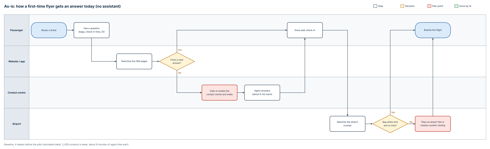
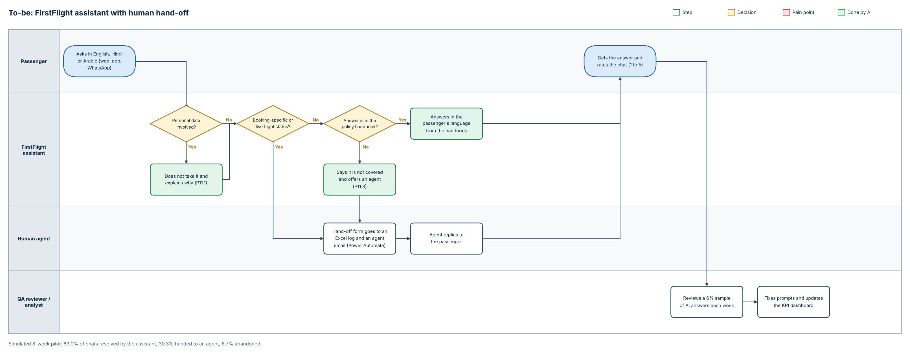
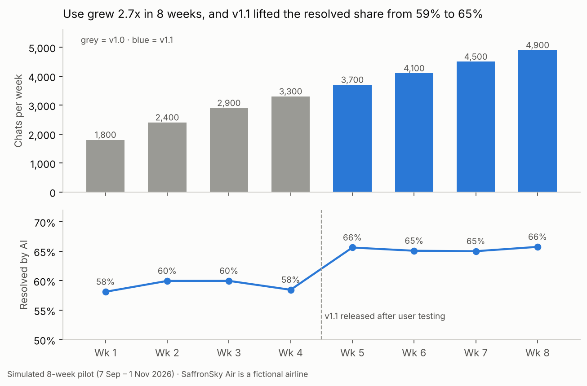
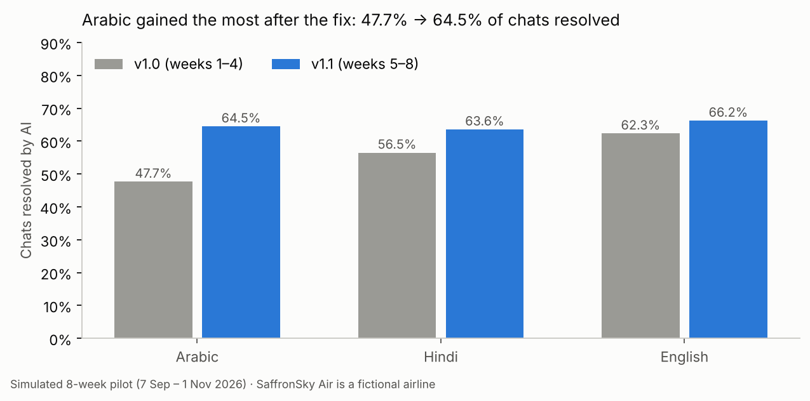
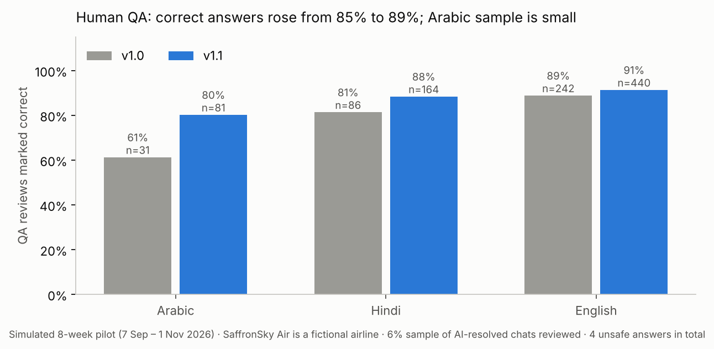
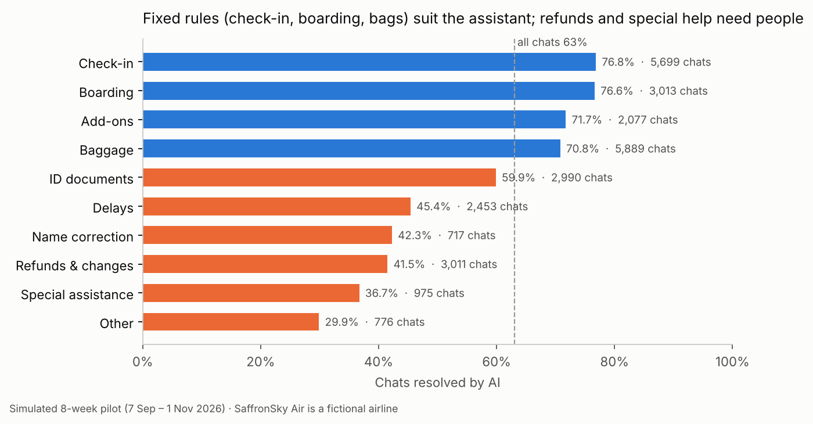
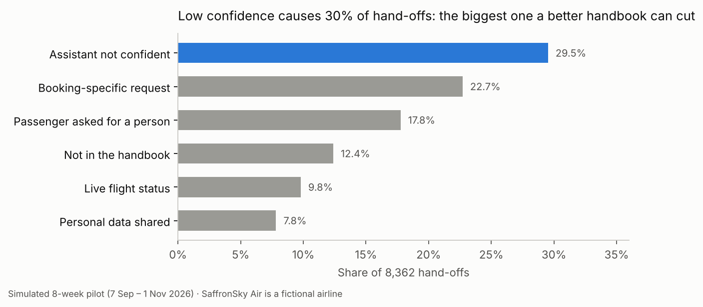
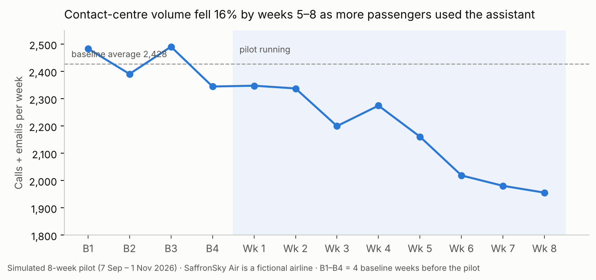
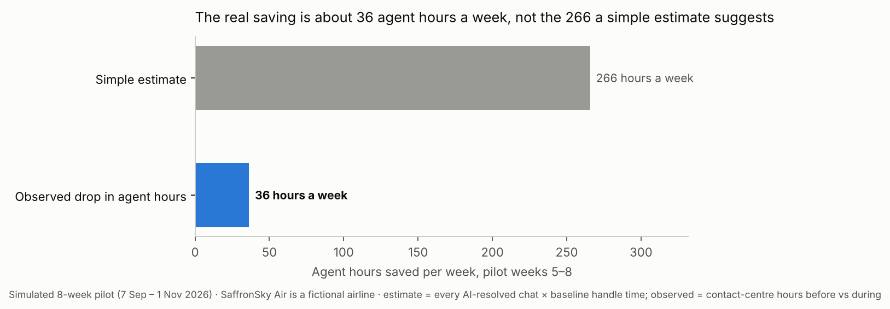

# FirstFlight: AI Boarding Assistant for First-Time Flyers

**Status: in progress.** Ready: policy handbook, benchmark questions, simulated pilot data, SQL analysis with results, as-is and to-be process maps, user stories and requirements, and the prompt library. Not built yet: the AI assistant itself, the hand-off automation, the Power BI dashboard, the AI tool benchmark scores and user testing. Step-by-step build guides for those are in [`docs/`](docs/).

## Why this project

My [Cabin Pressure](https://github.com/Salil360-cyber/Cabin-Pressure-Airline-Satisfaction-Research) analysis of 129,880 real airline passenger survey responses found that:

- first-time flyers are about half as satisfied as returning passengers (**24.0% vs 50.6%**), and
- online boarding is the biggest single driver of satisfaction (**28.5%** of the key-driver weight).

FirstFlight takes that finding to a solution: an AI assistant that guides passengers through check-in, baggage and boarding in **English, Hindi and Arabic**, and hands anything it cannot answer to a human agent.

> **Simulated data.** SaffronSky Air is a fictional low-cost airline. Its policy handbook and all pilot data were written or generated for this project and do not describe any real airline. The benchmark answers must be produced by actually testing the AI tools.

## Process maps

**As-is:** how a first-time flyer gets an answer today.



**To-be:** the FirstFlight assistant with human hand-off.



Editable versions (`.drawio`) are in [`process_maps/`](process_maps/); open them at app.diagrams.net. The stories and requirements behind the to-be map are in [`docs/01_user_stories_and_requirements.md`](docs/01_user_stories_and_requirements.md).

## Pilot results so far (simulated data)

These charts come from the simulated 8-week pilot. Every number is checked against the answer key by `scripts/charts.py`.



| | |
|---|---|
|  |  |
|  |  |
|  |  |

| What | Result |
|---|---|
| Chats after cleaning | 27,600 (from 27,830 raw) |
| Resolved by the assistant | **63.0%** (v1.0 59.2% → v1.1 65.4%) |
| Arabic chats resolved | **47.7% → 64.5%** after the v1.1 fix |
| First-time flyers who gave up | 8.2% vs 5.6% for returning passengers |
| Human QA: answers correct | 84.7% → 89.3%; 4 unsafe answers in 1,044 reviews |
| Contact-centre volume, weeks 5–8 vs baseline | **−16.4%** |
| Agent hours saved | **about 36 a week observed**, vs 266 a week from a simple estimate |

The gap in the last row is the main lesson: counting every resolved chat as a call avoided overstates the saving, because many people who chat would never have called.

## The plan (solutions-analyst workflow)

| # | Step | Tool | Status |
|---|---|---|---|
| 1 | Problem statement from Cabin Pressure findings | Python, SQL | ✅ Done (earlier project) |
| 2 | Pain-point interviews with first-time flyers | Google Forms | ⏳ |
| 3 | As-is and to-be process maps (booking → gate) | draw.io | ✅ Done: [`process_maps/`](process_maps/) |
| 4 | User stories and functional requirements | Markdown | ✅ Done: [`docs/01`](docs/01_user_stories_and_requirements.md) |
| 5 | Policy handbook the assistant must follow (11 sections) | Markdown | ✅ Ready |
| 6 | AI tool benchmark: 54 questions × 4 tools (Gemini, ChatGPT, Copilot, NotebookLM) | Excel | ✅ Questions ready · ⏳ testing not done ([guide](docs/06_benchmark_and_user_testing_guide.md)) |
| 7 | Prompt library and templates | Markdown | ✅ Done: [`docs/02`](docs/02_prompt_library.md) |
| 8 | MVP assistant with human hand-off | Google AI Studio | ⏳ Not built ([build guide](docs/03_build_the_assistant_in_ai_studio.md)) |
| 9 | Hand-off automation: form → Excel log → agent email | Power Automate | ⏳ Not built ([build guide](docs/04_power_automate_handoff_guide.md), [log template](templates/handoff_log_template.xlsx)) |
| 10 | User testing with 5 people, one improvement round | Google Forms | ⏳ Not done ([guide](docs/06_benchmark_and_user_testing_guide.md)) |
| 11 | Pilot data analysis: adoption, resolution rate, QA, workload | SQL (PostgreSQL) | ✅ Done: [`analysis/sql_results.md`](analysis/sql_results.md) |
| 12 | Adoption KPI dashboard | Power BI | ⏳ Not built ([build guide](docs/05_power_bi_dashboard_guide.md)) |
| 13 | How-to guide, demo video, findings deck | PowerPoint | ⏳ |

## Data (simulated 8-week pilot, 7 Sep – 1 Nov 2026)

| File | Rows | What it is |
|---|---|---|
| `data/sessions.csv` | 27,830 raw (27,600 clean) | Every chat with the assistant: channel, language, passenger type, topic, app version, outcome, hand-off reason, CSAT |
| `data/agent_tickets.csv` | 8,362 | Chats handed to a human agent: wait time, handle time, resolution |
| `data/qa_reviews.csv` | 1,044 | Human QA review of a 6% sample of chats the assistant answered itself |
| `data/contact_centre_contacts.csv` | 26,989 | Calls and emails to the contact centre, 4 weeks before and 8 weeks during the pilot |
| `benchmark/benchmark_questions.csv` | 54 | Test questions with the correct answer and the handbook section |
| `benchmark/AI_Tool_Benchmark_Scoring.xlsx` | 216 | Scoring sheet: 54 questions × 4 tools, with a scoring rubric |
| `data/sessions_clean.csv` | 27,600 | The chats after cleaning (output of `sql/02_clean_view.sql`), ready for Power BI |
| `sql/` | 3 files | PostgreSQL: create tables, clean view, 14 analysis queries |
| `analysis/sql_results.md` | 14 queries | Actual query outputs from PostgreSQL 16, with a short summary |

`sessions.csv` contains six kinds of known data issues (duplicate rows, internal test chats, mixed language labels, out-of-range CSAT, missing and impossible end times). Finding and handling them is part of the analysis. The data dictionary is in [`data/README.md`](data/README.md).

## Reproduce

```bash
pip install pandas numpy openpyxl duckdb tabulate matplotlib
python scripts/make_benchmark.py   # benchmark questions + scoring sheet
python scripts/generate_data.py    # simulated pilot data (seeded, same result every time)
python scripts/answer_key.py       # cleaning + KPIs, checked twice (pandas and DuckDB SQL)
python scripts/charts.py           # report charts, checked against the answer key
python scripts/make_process_maps.py  # as-is and to-be process maps (PNG + draw.io)
```

---
Author: **Salil Gokhale** · [LinkedIn](https://www.linkedin.com/in/salil-gokhale-analytics) · [Portfolio](https://salil360-cyber.github.io/portfolio/?focus=aviation)
